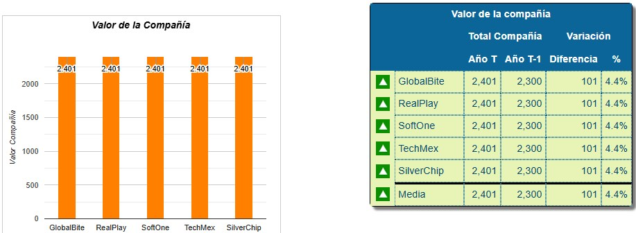

# Plantilla Maestra — Presentaciones de Simuladores CompanyGame

> **Esta carpeta es una PLANTILLA.** Para una presentación nueva, cópiala completa,
> renómbrala (p. ej. `businessglobal-presentacion/`) y rellena los slides variables.
> Distribuidor: **Simuladores de Negocios Colombia** (Grupo Edutec).

## Cómo se construye una presentación nueva

1. **Copiar** esta carpeta y renombrarla con el nombre del simulador.
2. Decirle a Claude: *"Esta presentación es para el simulador **[NOMBRE]**"* y darle la
   información del simulador (manual, capturas, datos).
3. Claude **reemplaza los tokens `[[...]]`** y **rellena los slides variables**, conservando
   los slides fijos tal cual.
4. Guardar las imágenes específicas en `assets/` (ver **Convenciones de imágenes** abajo).

## Convenciones de imágenes (estándar Corbatul — la presentación más pulida)

- **Formato y nombre descriptivo**: las capturas van en **`.jpg`** (pesan menos que PNG) con
  nombre que dice qué son, no numerado. Ej. Cuadro de Mando → `cm-valor.jpg`, `cm-marketing.jpg`,
  `cm-produccion.jpg`; Decisiones → `dec-capital.jpg`, `dec-ventas.jpg`, `dec-produccion.jpg`.
  (El logo, cartelera y avatares conservan su formato original.)
- **Siempre clicables (lightbox)**: cada `` de captura lleva
  `onclick="openLightbox('assets/x.jpg','Título descriptivo')"` y `loading="lazy"`.
- **Tamaño / encuadre — igual para TODAS las capturas de Cuadro de Mando y Decisiones**:
  - En el slide se ven **pequeñas y todas del mismo tamaño**: caja de **520 × 260 px** con
    `object-fit:contain` (no se recortan ni deforman) y el aviso «🔍 Haz clic en la imagen para ampliarla».
    Lo controla el CSS (`.dec-shot img`): **no pongas `width`, `height` ni `style` inline** en las capturas.
  - Al hacer clic se abren completas en el lightbox (`max-height:86vh`).
- **Organización — recorrido por pasos (varias pantallas por slide)**: el Cuadro de Mando y las
  Decisiones usan **siempre** el componente de pasos `.plan-steps` + `.plan-panel` (ver la sección
  «Cuadro de Mando y Decisiones» más abajo). **No uses `.cm-grid` / `.cm-card` ni `.cm-masonry`** en
  presentaciones nuevas, y no dividas en «Parte 1 / Parte 2».

## Tokens a reemplazar (búscalos con `[[`)

| Token | Qué es | Ejemplo (FoodCompany) |
|-------|--------|------------------------|
| `[[SIMULADOR]]` | Nombre del simulador | FoodCompany |
| `[[SUBTITULO]]` | Subtítulo de portada | Simulador de Gestión de una Empresa del Sector Lácteo |
| `[[PARRAFO_CONTEXTO]]` | 2-3 frases de qué es | … dirige una compañía láctea … |
| `[[NIVEL]]` | Nivel / dificultad | Nivel 4 · Estratégico |
| `[[DURACION]]` | Duración | 16–32 horas |
| `[[LINEAS_PRODUCTO]]` | Badge de líneas/foco | 🥛🥣🧀 3 Líneas de Producto |
| `[[AREA_CONOCIMIENTO]]` | Área CompanyGame | Marketing y Ventas |
| `[[EMOJI]]` | Emoji de marca (cierre) | 🥛 |
| `[[SUBTITULO_*]]`, `[[TITULO_*]]`, `[[FACTORES_VALOR]]` | Títulos/subtítulos de slides variables | — |

## Estructura: 18 slides (NO cambiar la cantidad sin actualizar el contador del nav)

| # | Slide | Tipo | Notas |
|---|-------|------|-------|
| 1 | Portada + Contexto | **FIJO** (estructura) | Branding CompanyGame; cambia solo nombre/imagen vía tokens |
| 2 | Cartelera de Simuladores | **FIJO** | Usa `assets/cartelera.jpg` y `assets/avatares.png` (portafolio CompanyGame) |
| 3 | Ingreso a la Plataforma | **FIJO** | URL `plataforma.companygame.net`; idéntico en todas |
| 4 | Divisoria — Entorno de Simulación | **FIJO** | `.section-divider`; separa "acceso" de "contenido del simulador" |
| 5 | Manual del Simulador | **FIJO** (portada/link pendientes) | Portada `assets/manual-cover.png` + botón de descarga; llega con placeholders `.reserved` hasta que se suba el manual real |
| 6 | ¿Qué es? | variable | Tarjetas `.card-grid cols4` |
| 7 | Cadena de Valor | variable | `.value-chain` + `.card-grid` |
| 8 | Producción / Insumos | variable | `.data-table` + tarjetas |
| 9 | Áreas de Decisión | variable | `.card-grid` |
| 10 | Segmentos | variable | `.two-col` + `.seg-row` — **sin factores de competitividad**, esa sección se eliminó |
| 11 | Valor de la Compañía | variable | `.factor-accordion` con % — va **antes** de Cuadro de Mando, no después |
| 12 | Divisoria — Cuadro de Mando | **FIJO** | `.section-divider` |
| 13 | Cuadro de Mando | variable | Recorrido por pasos (`.plan-steps` + `.plan-panel`) · **todas las capturas en un solo slide** · capturas `assets/cm-<nombre>.jpg` |
| 14 | Divisoria — Decisiones del Simulador | **FIJO** | `.section-divider` |
| 15 | Decisiones del Simulador | variable | Recorrido por pasos (mismo componente que Cuadro de Mando) · un slide, o uno por grupo si las capturas vienen agrupadas · capturas `assets/dec-<nombre>.jpg` |
| 16 | Métodos de Implementación | **FIJO** | Genérico (deductivo/inductivo/mixto/alternos) |
| 17 | Preguntas Frecuentes | variable (semi) | Preguntas reutilizables; ajustar respuestas del simulador |
| 18 | Cierre / Gracias | **FIJO** | Contacto del distribuidor (email + WhatsApp + logo SDN) + redes sociales (LinkedIn/YouTube/Web) |

Cada slide variable trae un `<div class="reserved">` con instrucciones y un comentario
`<!-- VARIABLE · ... -->` que indica el componente recomendado.

### Segmentos (slide 10) — ya NO lleva competitividad

La antigua sección "Segmentos y Competitividad" se simplificó a solo **Segmentos**: segmentos
de demanda + canales de distribución. El acordeón de factores de competitividad (Precio/Marca/
Producto/Cobertura por segmento) se eliminó de esta familia de presentaciones — no lo agregues
en presentaciones nuevas ni lo reincorpores en las existentes.

### Cuadro de Mando (slide 13) y Decisiones (slide 15) — recorrido por pasos (varias pantallas por slide)

Ambas usan **el mismo componente**, tomado de la Planificación de Focus (referencia terminada:
`salesmanager-presentacion`): una fila de pasos numerados arriba y, debajo, el panel de la pantalla
elegida. Así caben muchas capturas en **un solo slide** sin «Parte 1 / Parte 2».

```html
<div class="phase-intro">
    <span class="badge badge-teal">11 pantallas</span>
    <span>Frase corta que explique en qué orden recorrer las pantallas.</span>
</div>
<div class="plan-steps" style="--steps:11">   <!-- --steps = nº de pantallas -->
    <button class="plan-step active" onclick="showPlanStep(this,1)"><span class="ps-num">1</span><span class="ps-label">Valor</span></button>
    <button class="plan-step" onclick="showPlanStep(this,2)"><span class="ps-num">2</span><span class="ps-label">Indicadores clave</span></button>
    <!-- … un botón por pantalla … -->
</div>
<div class="plan-panel active" data-step="1">
    <div class="dec-block">
        <div class="dec-head"><div class="dec-num">1</div><div><h3>🏆 Valor</h3><p>Qué muestra el informe / qué decides.</p></div></div>
        <div class="plan-tabs"><span class="plan-tabs-label">Categoría:</span><span class="plan-tab">Resultado</span></div>  <!-- opcional -->
        <div class="plan-why"><span class="cm-why-label">💡 Por qué analizarlo</span><p class="cm-why-text">Explicación pedagógica.</p></div>
        <div class="dec-shot"></div>
    </div>
</div>
<!-- … un .plan-panel (data-step="n") por pantalla; solo el primero lleva "active" … -->
```

- **Cuadro de Mando**: todas las capturas en **un solo slide** de pasos, sin importar cuántas sean.
  El bloque se titula «💡 Por qué analizarlo».
- **Decisiones**: mismo componente; el bloque se titula «💡 Por qué importa». Por defecto, todas las
  pantallas en un solo slide. **Si las capturas vienen agrupadas** (subcarpetas como «Precio - Promoción»,
  «Equipo», «Reuniones»…), haz **un slide de pasos por grupo**, todos después de la divisoria de
  Decisiones, y actualiza el contador. Un grupo con una sola captura va como un `.dec-block` sin `.plan-steps`.
- `.plan-tabs` es opcional: úsalo para listar pestañas internas o lo que se decide en la pantalla.
- La función `showPlanStep()` ya está en el `<script>` de la plantilla; no la dupliques.

### Valor de la Compañía (slide 11) — estructura fija de acordeón

Usa **siempre** el mismo componente que FoodCompany: `<div class="factor-accordion">` con un
`<div class="factor-item">` desplegable por factor (variantes `factor-orange/amber/green/teal/
purple/red/blue`), cada uno con `.factor-tag` (el %) y, al desplegar, `Descripción` / `¿Qué
evalúa?` / `.factor-consejo`. Solo cambian los factores, los % y el texto — no el componente.
Esta slide va **antes** de la divisoria de Cuadro de Mando, no después.

### Slides divisorias (`.section-divider`)

Marcan el inicio de un bloque grande de contenido (fondo degradado `--primary → --amber`,
ícono grande animado, texto corto). Estructura mínima:

```html
<div class="slide" id="slideN">
    <div class="section-divider">
        <div class="sd-icon">🖥️</div>
        <div class="sd-eyebrow">Sección</div>
        <h1>Título de la sección</h1>
        <p>Frase corta de contexto</p>
        <div class="sd-rule"></div>
    </div>
</div>
```

No llevan `.slide-header` ni `.slide-number`. Usan el mismo degradado de la plantilla
(`var(--primary)`/`var(--amber)`) — al cambiar la paleta por simulador, se adaptan solas.

## Componentes de estilo disponibles (ya en el CSS)

- **Tarjetas**: `.card-grid` / `.card-grid.cols4` + `.card` (variantes `bd-amber/green/teal/purple/red`)
- **Tabla**: `.data-table`
- **Flujo**: `.value-chain` + `.chain-box` (`cb-amber/green/teal`)
- **Acordeón de factores**: `.factor-accordion` + `.factor-item` (`factor-orange/amber/green/teal/purple/red/blue`)
- **Recorrido por pasos (Cuadro de Mando y Decisiones)**: `.phase-intro` + `.plan-steps` (`--steps:N`) + `.plan-step` +
  `.plan-panel` con `.dec-block` → `.dec-head` / `.plan-tabs` / `.plan-why` / `.dec-shot` — varias pantallas por slide.
  (`.cm-grid` + `.cm-card` y `.cm-masonry` quedan solo por compatibilidad con presentaciones antiguas — no usarlos.)
- **Acordeón FAQ**: `.accordion` + `.accordion-item`
- **Dos columnas**: `.two-col` · **Segmentos**: `.seg-row` · **Badges**: `.badge` (`badge-orange/green/teal/amber/purple`)
- **Lightbox** de imágenes: `onclick="openLightbox('assets/x.jpg','Título')"` + `loading="lazy"`

## Paleta (identidad CompanyGame/FoodCompany — ajustable por simulador)

```
--primary:#F58220  --primary-dark:#E06D10  --amber:#F9A825
--accent-green:#7BC143  --accent-teal:#00B4D8  --accent-purple:#9B59B6
--cg-blue:#1A5276
```
Si el simulador tiene identidad propia, cambia estas variables en `:root`.

> **TechCompany usa paleta de azules y grises** (no la naranja): `--primary:#1F5F99`
> `--primary-dark:#154A7A` `--primary-light:#5B8DBE` `--amber:#5D7285` (gris pizarra)
> `--accent-green:#3A7CA5` `--accent-teal:#2E9CCA` `--accent-purple:#6C7A89` `--accent-red:#4A5568`.
> Los colores fijos del CSS (degradados, tintes claros, factores, métodos) también se pasaron a azul/gris.

## Datos fijos del distribuidor (no cambian entre simuladores)

- Plataforma de acceso: **https://plataforma.companygame.net/**
- Email: **fidelizacion@simuladoresdenegocios.co**
- WhatsApp: **301 790 3086** (`https://wa.me/573017903086`)
- Logo distribuidor: `assets/logo-sdn.png`
- Redes sociales (slide de Cierre, `.social-row` con `.social-icon`):
  - LinkedIn: `https://co.linkedin.com/company/simuladores-de-negocios-colombia-sas`
  - YouTube: `https://www.youtube.com/@SimuladoresdeNegocios/videos`
  - Página web: `https://simuladordenegocios.co/`

## Tecnología

HTML5 + CSS3 + JS vanilla, todo embebido en `index.html`. Sin frameworks. Navegación por
flechas/teclado/swipe ya implementada. No tocar el `<script>` salvo que cambie el nº de slides.
